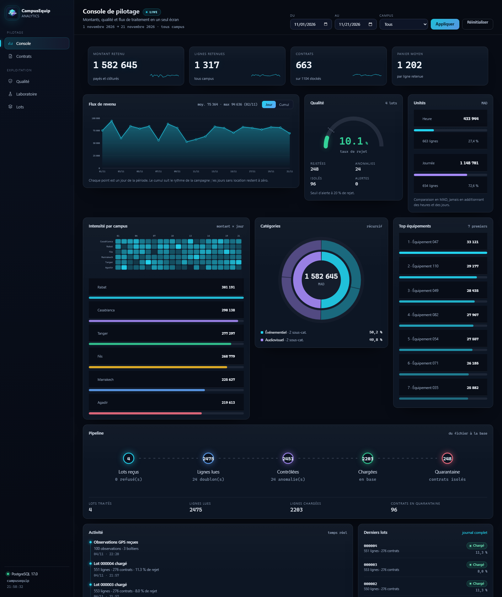
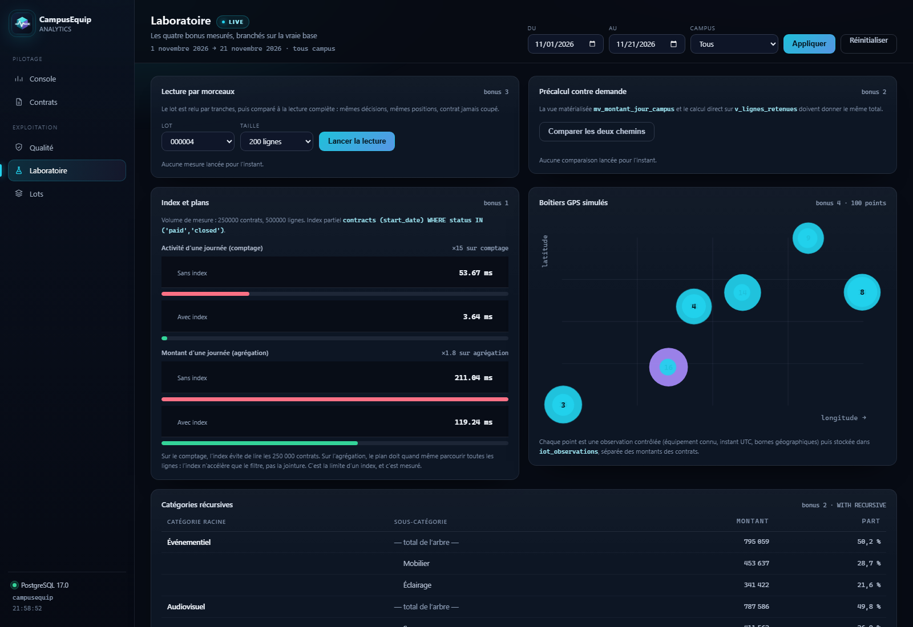

# CampusEquip — axes 1 à 4

Binôme : **à compléter** (nom 1, nom 2) — remises des axes 1–2 : 21 novembre ;
axes 3–4 : 23 novembre 2026.

Ce projet transforme les fichiers de locations de CampusEquip en données fiables
dans PostgreSQL, puis en indicateurs SQL. Le pipeline des axes 1–2 fournit la
modélisation relationnelle, les contrôles Python, la quarantaine, le chargement
transactionnel et le rejeu automatique. L'extension [axes 3–4](axes_3_4/README.md)
ajoute MongoDB, Redis, Airflow et TimescaleDB sans changer les règles métier du
socle.

**Démarrage rapide** — avec Docker (rien à installer, base comprise) :

```powershell
Set-Location .\CampusEquip_etudiant
docker compose up -d --build
```

Console : http://localhost:5055 par défaut (ou la valeur de `APP_HOST_PORT`
dans `.env`). Airflow : http://localhost:8080. La base PostgreSQL, son schéma
et les données de démonstration sont créés au premier démarrage. Voir
[DOCKER.md](DOCKER.md) pour les autres commandes et le changement de ports.

**Frontend CampusEquip** — une expérience avec administrateur, responsable de
campus et équipe de comptoir. Il lit les vraies données du projet en lecture
seule via l'API Flask; les rôles restent des aperçus d'interface :

```powershell
docker compose up -d --build
docker compose --env-file .env -f app/docker-compose.yml up -d
```

Ouvrez http://localhost:5173. Si l'API est indisponible, l'interface l'indique
et revient aux données d'exemple. Le mode connecté est en lecture seule et ne
modifie pas les bases. Si aucun `.env` n'est présent et que vous utilisez les
ports par défaut, retirez `--env-file .env`. Détails :
[app/README.md](app/README.md).

Ou en local (Python 3.10+ et PostgreSQL 13+) :

```powershell
pip install -r requirements.txt
$env:DATABASE_URL = "postgresql://campusequip@127.0.0.1:5432/campusequip"
python -m outils.init_base      # crée la base si besoin et applique le schéma
python -m outils.demo           # génère 4 lots, charge, rejoue, analyse
```

Le détail Docker (commandes, volumes, dépannage) est dans **[DOCKER.md](DOCKER.md)**.
Pour l'orchestration et les services complémentaires, consultez
**[axes_3_4/README.md](axes_3_4/README.md)**.

---

## 1. Ce que fait le pipeline

Un lot est un dossier contenant `locations.csv`, `referentiels.json`,
`manifest.json` et le marqueur `READY`. Le surveilleur détecte les dossiers
complets et appelle `traiter_lot`, qui applique toujours le même ordre :

1. **structure** — les quatre fichiers sont là, le manifeste décrit exactement
   les deux sources, les empreintes SHA-256 correspondent, l'en-tête du CSV
   contient les onze colonnes dans l'ordre attendu. Sinon : `REJETE_STRUCTURE`,
   aucune écriture métier.
2. **normalisation** — espaces périphériques retirés, `status` et `unit` en
   minuscules ; aucune autre réparation, aucune valeur inventée.
3. **répétitions exactes** — une seule occurrence conservée, comptée une fois.
4. **contrôles de ligne** — identifiants, date, statut, quantité, unité, durée,
   tarif (`Decimal`), existence des références.
5. **cohérence du contrat** — client, site, date et statut identiques sur toutes
   les lignes ; pas deux contenus pour la même clé `(contract_id, line_no)`.
   Une seule ligne invalide met **tout le contrat** en quarantaine.
6. **chargement** — journal, référentiels (au premier lot), contrats, lignes,
   quarantaine et anomalies dans **une seule transaction**. Un rejeu est reconnu
   par la signature du lot, pas par la mémoire du programme.

Le montant d'une ligne est une colonne calculée par PostgreSQL
(`quantity * duration * unit_rate`) : l'indicateur ne peut pas diverger du tarif
historique reçu. Seuls les contrats `paid` et `closed` entrent dans les
indicateurs ; `draft` et `cancelled` restent stockés mais sont exclus.

## 2. Installation

Prérequis : **Python 3.10+** et **PostgreSQL 13+** (testé avec PostgreSQL 17).

```powershell
python -m venv .venv
.venv\Scripts\Activate.ps1
pip install -r requirements.txt
```

Sous Linux/macOS : `python3 -m venv .venv && . .venv/bin/activate`.

Dépendances : `psycopg2-binary` (connexion PostgreSQL), `Flask` (console web)
et `Pillow` (graphiques PNG). `python-docx` n'est nécessaire que pour
régénérer `RAPPORT.docx`.

## 3. Connexion à la base

Pour une base locale, la connexion vient de l'environnement :

```powershell
$env:DATABASE_URL = "postgresql://campusequip@127.0.0.1:5432/campusequip"
```

ou, si `DATABASE_URL` n'est pas définie, des variables standard libpq
(`PGHOST`, `PGPORT`, `PGDATABASE`, `PGUSER`, `PGPASSWORD`).

Sur votre poste, vous pouvez déposer un fichier `.env` à la racine du projet
(copie de `.env.exemple`). Il est lu automatiquement et ne doit **jamais** être
remis ni versionné (voir `.gitignore`).

La pile Docker de démonstration utilise des identifiants fixes (`campusequip`)
pour simplifier le démarrage local ; ils ne sont pas adaptés à un déploiement.
Les ports exposés de PostgreSQL sont limités à l'interface locale.

Création d'un rôle dédié, une seule fois, avec `psql` :

```sql
CREATE ROLE campusequip LOGIN PASSWORD 'un-mot-de-passe-local';
CREATE DATABASE campusequip OWNER campusequip;
```

## 4. Préparer une base neuve

```powershell
createdb -U campusequip campusequip
$env:DATABASE_URL = "postgresql://campusequip@127.0.0.1:5432/campusequip"
python -m outils.init_base --verifier      # contrôle des objets
```

`python -m outils.init_base` crée la base si elle n'existe pas, applique
`etudiant/schema.sql` et vérifie les 12 objets attendus.
`--reinitialiser` vide le schéma `public` avant de le recréer (base de
démonstration uniquement). Sans psql, tout passe par ce lanceur.

Équivalent avec psql :

```powershell
createdb -U campusequip campusequip
psql -U campusequip -d campusequip -v ON_ERROR_STOP=1 -f etudiant/schema.sql
```

**Une seule campagne par base.** Le premier lot chargé mémorise la campagne et
l'empreinte des référentiels dans `lab_config` ; tout lot d'une autre campagne
est refusé (`REJETE_STRUCTURE`, motif `CAMPAGNE_REFUSEE`). Pour une nouvelle
campagne, créez une **base neuve** (par exemple `campusequip_essai2`) et un
**nouveau dossier de flux**.

## 5. Démonstration complète en une commande

```powershell
python -m outils.demo
```

Le script enchaîne : base neuve + schéma, génération de 4 lots de 300 contrats
(profil `mixte`), chargement automatique par `surveiller.py`, **rejeu** des
mêmes lots, puis analyses SQL, tableaux et graphiques. Il affiche un bilan lot
par lot. Résultat attendu sur le jeu livré :

| Lot | Statut | Lignes acceptées | Rejetées | Contrats | Taux de rejet | Alerte |
|---|---|---:|---:|---:|---:|---|
| 1 | CHARGE | 549 | 60 | 276 | 9,85 % | non |
| 2 | CHARGE | 550 | 70 | 276 | 11,29 % | non |
| 3 | CHARGE | 553 | 48 | 276 | 7,99 % | non |
| 4 | CHARGE | 551 | 70 | 276 | 11,27 % | non |

Puis 4 rejeux `DEJA_CHARGE`, sans aucun ajout. Les chiffres exacts du dernier
chargement sont dans `resultats/synthese.md` et `RAPPORT.md`.

## 6. Traiter un lot déjà présent

Les deux lots propres du kit sont dans `exemples/` :

```powershell
python surveiller.py --entree exemples --une-fois --intervalle 1
```

Chaque lot produit un rapport JSON + Markdown dans `rapports/`, un fichier de
quarantaine dans `quarantaine/`, et une ligne dans `ingestion_batches`.

## 7. Générer un flux et le surveiller

Deux terminaux, depuis la racine du kit. Terminal 1 :

```powershell
python generer.py --sortie flux --contrats 1000 --intervalle 10
```

Terminal 2, après avoir préparé la base et configuré `DATABASE_URL` :

```powershell
python surveiller.py --entree flux --intervalle 2
```

Sans `--lots`, le générateur tourne jusqu'à `Ctrl+C`. `--lots 3` produit
exactement trois lots puis s'arrête. `--une-fois` traite les lots présents et
rend un code de sortie non nul si un lot échoue. **Gardez les mêmes paramètres
`--contrats`, `--graine` et `--profil` pour une reprise dans le même dossier**,
et ne supprimez pas `generator-state.json`.

Pour un premier essai propre, deux petits lots :

```powershell
python generer.py --sortie essai --contrats 20 --lots 2 --profil propre --intervalle 0
python surveiller.py --entree essai --une-fois --intervalle 1
```

## 7 bis. Banc de charge (défi facultatif)

Le banc de charge génère des lots à débit contrôlé et les fait passer par le
vrai pipeline PostgreSQL (contrôles, dédoublonnage, quarantaine et transaction).
Il mesure chaque palier et conserve un rapport JSON :

```powershell
python -m outils.stress --debits 10,100,1000,10000 --duree 3
```

Chaque palier dure le nombre de secondes indiqué et publie un lot par seconde.
Le profil `mixte` inclut les cas de qualité du générateur habituel. Le rapport
contient les volumes générés, reçus, traités, doublons, rejets, anomalies,
octets CSV, débit effectif, latence p95, pic de backlog, événements non reçus ou
non comptabilisés, valeurs/champs manquants, temps CPU du processus Python et
son pic mémoire. Un tarif absent est injecté par lot pour éprouver ce contrôle.
Le chemin du JSON s’affiche à la fin; il peut être choisi avec `--rapport`.

**Important :** lancez ce test sur une base PostgreSQL neuve et dédiée. Il
refuse explicitement une base déjà utilisée et ne la réinitialise jamais. Pour
chaque nouvelle série, créez un nouveau nom de base et appliquez le schéma :

```powershell
$env:DATABASE_URL = "postgresql://campusequip@127.0.0.1:5432/campusequip_stress"
python -m outils.init_base
python -m outils.stress --debits 10,100,1000,10000 --duree 3
```

La RAM et le CPU rapportés concernent le processus Python du banc, pas le
serveur PostgreSQL. Le temps de traitement mesuré inclut les opérations Python
et les attentes de la base; le test reste une simulation monoposte, pas une
preuve de capacité d’une architecture distribuée nationale.

## 8. Arrêter, reprendre, rejouer

* Arrêt : `Ctrl+C` dans les deux terminaux. Les fichiers sont conservés.
* Reprise : relancez `surveiller.py` sur le même dossier ; le journal SQL
  reconnaît les lots déjà chargés (`DEJA_CHARGE`) et reprend au suivant.
* Rejeu : relancer le même dossier ne double jamais les montants. La preuve est
  dans `rapports/` (deux rapports, le second avec `lignes_ajoutees_en_base: 0`).
* Si `.generator.lock` subsiste après un arrêt brutal, vérifiez qu'aucun
  générateur ne tourne avant de retirer **uniquement ce verrou**. Ne supprimez
  jamais `generator-state.json` pour forcer une reprise.

## 9. Analyses SQL

```powershell
python -m outils.analyses
```

Le script exécute `analyses.sql` sur la base, rafraîchit la vue matérialisée,
et écrit dans `resultats/` : un CSV et un extrait Markdown par analyse, les deux
graphiques PNG et `synthese.md`. Les trois analyses demandées :

| Analyse | Requête | Fichier produit |
|---|---|---|
| A1 montant par date et campus | `generate_series` sur 1–21 novembre, jours à zéro, cumul | `a1_montant_par_jour_campus.csv` |
| A2 équipements contributeurs | `DENSE_RANK()` par campus, rangs ex æquo | `a2_equipements_contributeurs.csv` |
| A3 heure ou journée | lignes et montants par campus et par unité | `a3_heure_ou_journee.csv` |

Le contrôle `controle_totaux` vérifie que les trois analyses somment le même
univers. Avec psql : `psql -d campusequip -f analyses.sql` (les marqueurs
`-- @resultat:` sont de simples commentaires).

## 9 bis. Console de pilotage et banc de charge

```powershell
python -m dashboard.app --port 5055
# http://127.0.0.1:5055
```

Application Flask locale, sans ressource réseau : les figures sont des **SVG
générés par le serveur**, la feuille de style et les interactions sont
embarquées. Elle utilise la même `DATABASE_URL` que le pipeline. Les pages
analytiques ouvrent une session PostgreSQL **READ ONLY**. La page Stress test
utilise une connexion distincte pour créer et supprimer un schéma temporaire
isolé; le rôle PostgreSQL doit donc avoir le droit `CREATE` sur la base. Les
tables et campagnes existantes ne sont pas modifiées.

| Page | Contenu |
|---|---|
| Console | indicateurs animés, flux de revenu jour / cumul, jauge qualité, carte de chaleur campus × jour, soleil des catégories, top équipements, pipeline, activité |
| Contrats | liste filtrable (période, campus, statut, numéro) et fiche détaillée avec le calcul ligne à ligne |
| Qualité | taux de rejet, motifs, lignes en quarantaine, anomalies acceptées |
| Laboratoire | les quatre bonus exécutés en direct : lecture par morceaux, précalcul contre demande, plans d’index, carte IoT |
| Stress test | paliers configurables, génération et chargement en direct, débit, latence, qualité, backlog et ressources |
| IoT Lab | atelier Arduino interactif : carte Uno et breadboard SVG, composants, connexions, capteurs, code, simulation et moniteur série |
| GPS Fleet | flotte de cinq traceurs simulés, carte Leaflet/OpenStreetMap, trajets, télémétrie, géorepérage et alertes persistés |
| Lots | journal des lots, état de la connexion, observations IoT |

**Ce qui rend l’interface vivante** : compteurs qui montent de zéro, courbe
tracée, barres qui poussent, arc de jauge animé, infobulles au survol, fil
d’activité rafraîchi toutes les 30 s, changement de filtre en fondu (View
Transitions) et respect de `prefers-reduced-motion`. Les interactions du
tableau de bord sont écrites en JavaScript natif dans `dashboard/static/app.js`
et `dashboard/static/iot_lab/`; la page GPS charge Leaflet depuis son CDN pour
la carte interactive.

La page **Stress test** permet de choisir les paliers 10, 100, 1 000 et
10 000 événements/s, leur durée et l’arrêt de la simulation. Les métriques
évoluent pendant le chargement réel des lots; le rapport JSON est téléchargeable.
Chaque essai crée un schéma PostgreSQL temporaire, distinct des données
analytiques, puis le supprime à la fin. Un seul essai peut tourner à la fois;
les paramètres sont plafonnés à 60 secondes par palier.

La page **Laboratoire** ne se contente pas d’afficher les bonus : le lecteur par
morceaux relit un vrai lot et compare ses décisions à la lecture complète ; le
comparateur mesure le précalcul et le calcul à la demande ; les plans d’index
viennent de `preuves/index_mesures.json` ; la carte IoT agrège les observations
réellement stockées.

Les filtres de période et de campus se propagent d’une page à l’autre. Si la base
est injoignable, l’application affiche une page d’erreur explicite (code 503) au
lieu d’une trace technique.

La page **IoT Lab** fournit dix circuits guidés, un Uno R3 et une breadboard SVG
annotés, l’ajout/déplacement/rotation de composants, le câblage des broches,
les propriétés des capteurs et un moniteur série horodaté. Le bouton Vérifier
valide le code et signale les connexions manquantes. Démarrer exécute un
sous-ensemble explicitement pris en charge d’Arduino C++ (variables numériques,
`setup()`/`loop()`, conditions, E/S numériques et analogiques, délai, série,
ultrason, Servo, LCD et DHT) dans un interpréteur JavaScript local. Le code
pilote les sorties et les composants simulés; ce n’est **pas** un compilateur
Arduino ni une émulation du processeur AVR, et aucun firmware n’est flashé sur
une carte réelle. Le bandeau de la page expose cette limite avant l’exécution.

La page **GPS Fleet** suit cinq appareils virtuels sur des itinéraires routiers
fixes à Casablanca, Rabat et Marrakech. La position progresse selon la distance
parcourue et la vitesse choisie; les coordonnées, le cap, l’altitude, le signal,
la batterie, l’historique et les entrées/sorties de géofence sont générés par
simulation, pas par du matériel GPS. Le stockage utilise exclusivement le schéma
PostgreSQL `gps_sim`, séparé des tables métier; le rôle applicatif doit pouvoir
créer ce schéma et y écrire. La carte nécessite un accès réseau au CDN Leaflet
et aux tuiles OpenStreetMap; si ces ressources manquent, la télémétrie et les
tableaux restent disponibles.





## 10. Tests

```powershell
$env:CAMPUSEQUIP_TEST_URL = "postgresql://postgres@127.0.0.1:5432/campusequip_test"
python -m unittest discover -s tests -t . -v
```

Les tests du socle utilisent une base jetable (le nom doit finir par `_test`,
sinon le module refuse de démarrer) ; douze tests ciblent la validation des axes
3–4 sans lancer les services externes. Les sorties sont isolées dans
`.tests_tmp/`. Les tests couvrent : parseurs, dédoublonnage, cohérence de
contrat, signature, montants, quarantaine complète du contrat, structure
invalide, rejeu (dossier renommé compris), conflit inter-lots, campagne
différente, référentiels modifiés, alerte au-delà de 20 %, trois lots
surveillés, échec visible et exécution du banc de charge isolée depuis le
tableau de bord.

Preuves complémentaires :

```powershell
python -m outils.valider         # recette complète : tout ci-dessous, dans l'ordre
python -m outils.preuve_alerte    # > 20 % de rejet : alerte sans blocage
python -m outils.preuve_calcul    # calcul d'un contrat à la main
python -m outils.preuve_bonus     # catégories récursives, précalcul vs à la demande
python -m outils.preuve_index     # plan SQL avant/après index (volume dédié)
python -m outils.preuve_morceaux  # lecture par morceaux = mêmes décisions
python -m outils.preuve_iot       # GPS simulé : acquisition, rejeu, panne
python -m outils.demo_cas --cas structure   # lot à en-tête incorrect (démo)
python -m outils.demo_cas --cas conflit     # contrat déjà chargé (démo)
python -m outils.rapport          # régénère RAPPORT.md et RAPPORT.docx
python -m outils.guide            # régénère GUIDE_PROJET.md, .docx et .pdf
```

## 11. Bonus réalisés

Le plafond des bonus des axes 1–2 est de 5 points ; le barème global des axes
1–4 prévoit 10 points bonus. Le tableau recense les preuves sans additionner de
points entre ces périmètres.

| Bonus | Où | Preuve |
|---|---|---|
| Index et plans SQL | `bonus/01_index.sql`, `outils/preuve_index.py` | `preuves/index_synthese.md` (×15 sur un comptage, résultat identique) |
| Catégories récursives + précalcul | `bonus/02_categories_recursives.sql`, `bonus/03_precalcul.sql` | `preuves/bonus_sql.md` (0 écart) |
| Lecture par morceaux | `bonus/lecture_morceaux.py`, `outils/preuve_morceaux.py` | `preuves/lecture_morceaux.md` (décisions identiques) |
| Source IoT simulée | `bonus/iot/`, `outils/preuve_iot.py` | `preuves/iot.md` (rejeu, panne, montants inchangés) |

## 12. Carte du dossier

```text
etudiant/
  schema.sql        modèle, contraintes, vues, journal
  regles.py         normalisation, contrôles, quarantaine, signature (sans SQL)
  traitement.py     lecture d'un lot, orchestration, rapports
  depot.py          chargement transactionnel, rejeu, refus
  config.py         connexion et chemins
analyses.sql        les trois analyses + contrôles
dashboard/          tableau de bord Flask (analyses en lecture seule, stress isolé) + captures
bonus/              index, récursif, précalcul, lecture par morceaux, IoT
axes_3_4/            MongoDB, Redis, DAG Airflow, mesures TimescaleDB et guide
outils/              init_base, demo, analyses, preuves, rapport, guide
tests/              fabrique de lots + tests axes 1–4
rapports/           un rapport JSON + Markdown par tentative
quarantaine/        un fichier JSONL par lot (lignes rejetées et motifs)
resultats/          CSV, Markdown, PNG, resultats.json, synthese.md
preuves/            tests, alerte, index, morceaux, IoT, analyses bonus
flux_demo/          jeu de démonstration livré (4 lots)
exemples/           les deux lots propres du kit
docs/README_kit.md  README d'origine du kit, conservé
docs/captures/      captures du tableau de bord (README et guide)
RAPPORT.pdf/.docx   rapport de 3 pages (+ annexes)
GUIDE_PROJET.pdf    guide complet : démarche, démo, discours, questions du jury
```

## 13. Limites connues

* Un seul processus traite les lots, dans l'ordre. Deux surveillants
  simultanés sont sérialisés par un verrou consultatif, sans plus.
* Le manifeste ne décrit pas le contenu attendu ligne à ligne : une ligne
  jamais reçue n'est pas détectable.
* `paid` est une convention pédagogique, pas une preuve d'encaissement.
* Les référentiels sont fixes par campagne (vérifié par empreinte), pas mis à
  jour de façon incrémentale.
* Le débit du générateur est volontairement simple ; ce n'est pas un système
  distribué.
* Le banc de charge est une commande locale, pas un contrôle interactif de la
  console web; ses essais nécessitent une base dédiée par série.

## 14. Aide IA

Conformément au sujet, consignez dans `journal_IA.md` les aides réellement
utilisées, ce qu'elles ont produit et les vérifications effectuées. Le rapport
`RAPPORT.md` / `RAPPORT.docx` tient en quatre pages hors annexes. Le
`GUIDE_PROJET.pdf` reprend tout le projet, avec le déroulé de démonstration,
le discours et les questions probables du jury.
